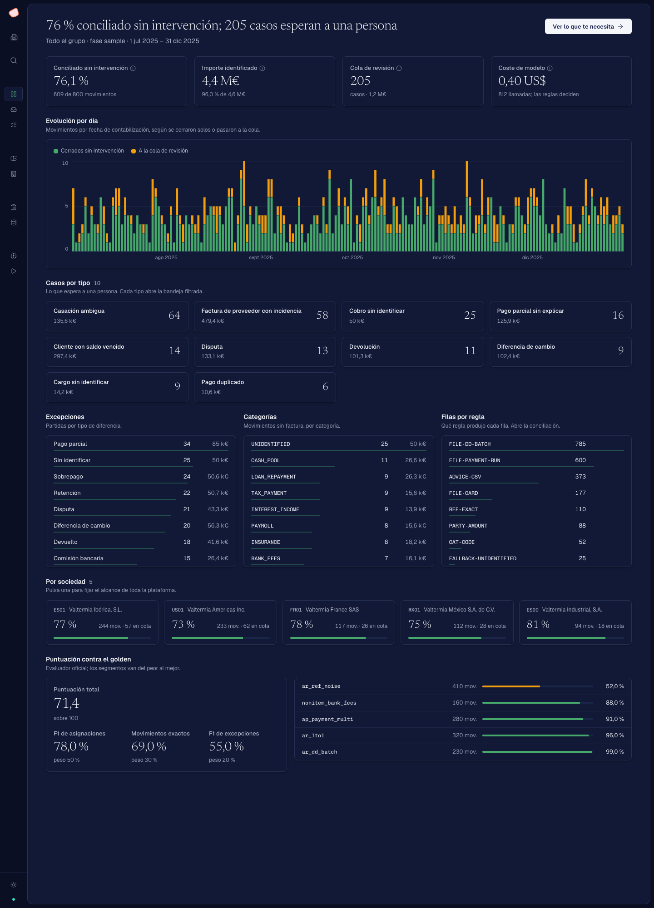
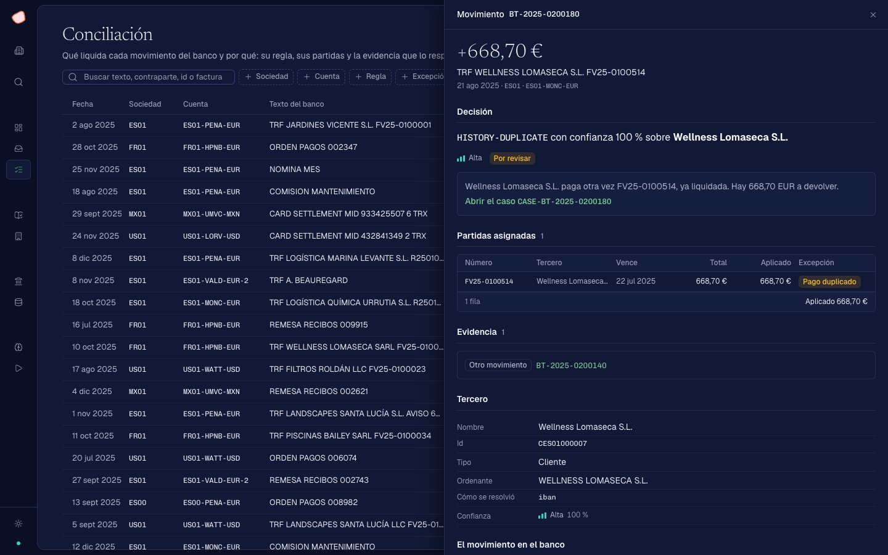

# Close the Books

Conciliador bancario y plataforma operativa para el **Claude Code Hackathon — Close the Books** (Madrid, 7 nov 2026). Reto y datos de Talky.

| Documento | Qué tiene |
| --- | --- |
| [PROBLEM.md](PROBLEM.md) | El reto: qué entra, qué se evalúa y qué falta por saber |
| [ARCHITECTURE.md](ARCHITECTURE.md) | Cómo está construido el repo y por qué |
| [CONTRACT.md](CONTRACT.md) | La carpeta de ejecución y la API: lo que el backend entrega a la plataforma |
| [CLAUDE.md](CLAUDE.md) | Cómo se trabaja en el repo |

## La plataforma

Una aplicación operativa sobre el resultado de cada ejecución, a escala real: 203.083 movimientos en LIVE, paginados por la API. El patrón es caso → decisión humana → memoria: el sistema cierra lo que tiene evidencia, y lo demás llega a una persona con su contexto.

| Pantalla | Ruta | Qué responde |
| --- | --- | --- |
| **Resumen** | `/` | Cuánto ha cerrado el sistema solo y qué necesita a una persona: evolución por día, casos por tipo, excepciones, reglas, sociedades y puntuación por segmento si hay golden |
| **Te necesitan** | `/bandeja` | Qué hay que decidir ahora: responder una pregunta, revisar un correo o marcar gestionado. Al responder, se puede guardar como regla |
| **Conciliación** | `/conciliacion` | Qué liquida cada movimiento y por qué: partidas, regla, evidencia abierta en línea, tercero y la línea tal como llega del banco |
| **Cobros** | `/cobros` | A qué clientes reclamar: tramos de vencimiento, disputas, duplicados a devolver y correo con las facturas adjuntas |
| **Proveedores** | `/proveedores` | Qué facturas de proveedor tienen incidencia y qué pedirle al proveedor |
| **Cuentas bancarias** | `/cuentas` | Las cuentas del grupo: banco, formato y su cambio, entradas y salidas, % conciliado |
| **Explorador** | `/explorador` | El paquete de datos: partidas, terceros, documentos con su texto y sus hechos, ficheros de detalle |
| **Memoria y reglas** | `/memoria` | Qué ha aprendido el sistema, quién se lo enseñó y a cuántos movimientos afecta; resumen de las políticas |
| **Ejecuciones** | `/ejecuciones` | Historial, comparación entre ejecuciones por segmento y consola de FINAL. **No hay botón de envío:** el envío lo hace una persona desde la terminal |

Los correos no se envían: «enviar» queda registrado en `runs/<id>/human/outbox.jsonl`.





El guion del vídeo está en [docs/DEMO.md](docs/DEMO.md).

## Puesta en marcha

**Necesitas:** Git, Node 22 y [`just`](https://github.com/casey/just). El paquete de datos y las ejecuciones viven en `db/` y `runs/`, fuera de git.

```bash
just fe-install
```

Con la API del backend, sobre una ejecución (ver [CONTRACT.md](CONTRACT.md) §5):

```bash
just be-serve runs/live-<fecha>
```

Sin datos ni backend, con el servidor de prueba de `app/mock/` y una ejecución sintética en `app/fixtures/run-sample/`:

```bash
npm --prefix app run mock
```

Y en otra terminal, la plataforma:

```bash
just fe-dev
```

Abre la dirección que imprime Vite. Vite pasa `/api` a `http://localhost:8000`; con `API_URL` se apunta a otro servidor.

### Comprobaciones

```bash
just fe-check
```

Pasa typecheck, lint, tests y build.

### Backend

`backend/` es el conciliador: lee una fase, aplica reglas por certeza y escribe la carpeta de ejecución de [CONTRACT.md](CONTRACT.md), que la API (`just be-serve`) sirve al frontend. Cómo se ejecuta y se mide: [backend/README.md](backend/README.md).
